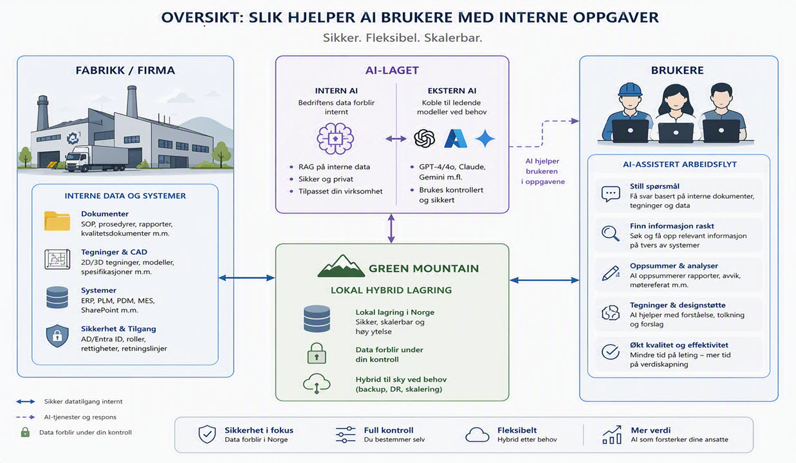
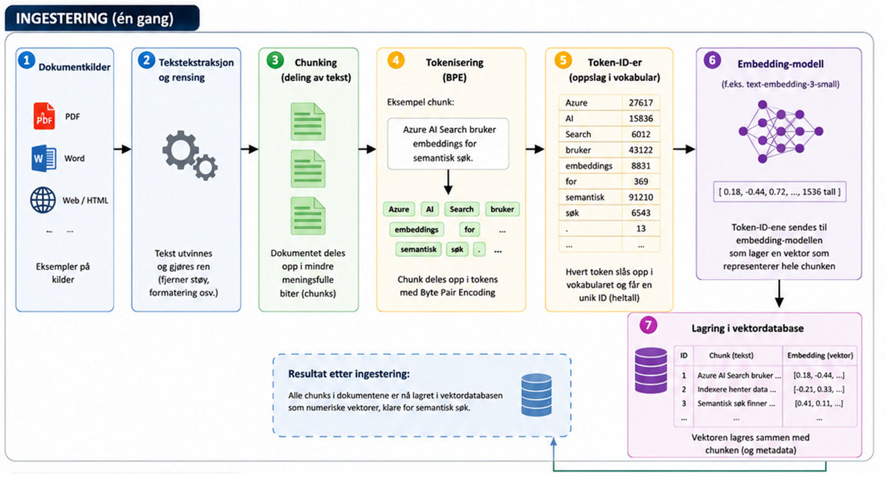

# RAG-kjeden: fra dokument til svar

**Mål:** Etter dette temaet kan du forklare hvert ledd i en RAG-løsning, hvorfor det trengs, og hvilke valg som påvirker kvaliteten på svarene.

**Forkunnskaper:** Du har brukt en KI-assistent. Litt Python er en fordel, men ikke et krav.

---

## 1. Hva er RAG, og hvorfor?

En språkmodell (LLM) vet bare det den ble trent på. Den kjenner ikke **dine** dokumenter, for eksempel personalhåndboken, kursportalen eller produktdokumentasjonen, og den kan **finne på** svar (hallusinere) når den ikke vet.

**Retrieval-Augmented Generation (RAG)** løser dette ved å:

1. **hente** (*retrieve*) de mest relevante tekstbitene fra dine dokumenter,
2. **legge dem til** (*augment*) i spørsmålet til modellen,
3. la modellen **generere** (*generate*) et svar basert på den teksten.

| Alternativ | Fordel | Ulempe |
|---|---|---|
| Bare LLM | Enkelt | Vet ikke noe om dine data, og kan hallusinere |
| **RAG** | Svarer ut fra oppdaterte dokumenter, kan vise kilder, og trenger ingen ny trening | Krever en datakjede som må vedlikeholdes |
| Finjustering (*fine-tuning*) | Modellen lærer stil og domene | Dyrt, blir utdatert, og gir dårlige kilder til fakta |

> Tommelfingerregel: Bruk **RAG for fakta og kunnskap** som endrer seg, og **finjustering for stil og format**.

### RAG i en bedrift: helheten



*Figur 1: Hvor RAG passer inn når en bedrift tar KI i bruk på egne data.*

Figuren viser de fire delene en bedrift må tenke på:

| Del i figuren | Hva det er | Kobling til RAG |
|---|---|---|
| **Fabrikk / firma: interne data og systemer** | Dokumenter (prosedyrer, rapporter, kvalitetsdokumenter), tegninger og CAD, systemer som ERP, PLM, MES og SharePoint, og tilgangsstyring i Entra ID | Dette er **kildene** som skal indekseres. Det er her svarene kommer fra. |
| **Lokal hybrid lagring** | Dataene lagres i et datasenter i Norge, med mulighet for sky ved behov (backup, katastrofegjenoppretting, skalering) | Her ligger dokumentene og **vektordatabasen**. Bedriften bestemmer hvor dataene bor. |
| **AI-laget** | **Intern AI** (RAG på interne data, privat og tilpasset) og **ekstern AI** (store språkmodeller som GPT, Claude og Gemini, brukt kontrollert) | RAG-søket skjer internt. Bare de få relevante tekstbitene sendes til språkmodellen sammen med spørsmålet. |
| **Brukere: AI-assistert arbeidsflyt** | Stille spørsmål, finne informasjon raskt, oppsummere og analysere, få hjelp med tegninger | Dette er **spørrefasen**: brukeren spør, og får svar med kilder fra bedriftens egne dokumenter. |

**Viktig poeng:** Pilen *Sikkerhet og tilgang* gjelder også RAG. En ansatt skal bare få svar fra dokumenter hun har lov til å se. Derfor lagrer man ofte hvem som har tilgang som **metadata** på hver chunk, og filtrerer søket på brukerens roller (*security trimming*).

---

## 2. Hele kjeden

RAG har to faser: **indeksering**, som gjøres på forhånd, og **spørring**, som skjer hver gang noen spør.

```text
 INDEKSERING (én gang, og ved endringer)
 ┌───────────┐   ┌────────────┐   ┌──────────────┐   ┌─────────────────┐   ┌──────────────┐
 │ Dokumenter│──▶│ ① Chunking │──▶│ ② Tokeniser- │──▶│ ③ Embedding-    │──▶│ ④ Vektor-    │
 │ PDF, MD … │   │ del opp    │   │ ing          │   │ modell → vektor │   │ database     │
 └───────────┘   └────────────┘   └──────────────┘   └─────────────────┘   └──────┬───────┘
                                                                                  │
 SPØRRING (hver gang)                                                             │
 ┌───────────┐   ┌────────────┐   ┌─────────────────┐   ┌─────────────────┐       │
 │ Spørsmål  │──▶│ Tokeniser- │──▶│ ③ Samme embed-  │──▶│ ④ Søk: finn de  │◀──────┘
 │ fra bruker│   │ ing        │   │ ding-modell     │   │ k mest like     │
 └───────────┘   └────────────┘   └─────────────────┘   └────────┬────────┘
                                                                 │ relevante chunks
                                                                 ▼
                                   ┌──────────────────────────────────────────────┐
                                   │ ⑤ LLM: «Svar på spørsmålet KUN ut fra        │
                                   │    teksten under. Oppgi kilde.» + chunks      │──▶ Svar med kilder
                                   └──────────────────────────────────────────────┘
```

### Ingestering steg for steg

Indekseringsfasen kalles også **ingestering** (*ingestion*). Figuren under viser hva som skjer med ett dokument fra det kommer inn til det ligger klart i vektordatabasen.



*Figur 2: Ingestering, fra dokumentkilde til vektor i databasen.*

| Steg | Hva skjer | Eksempel fra figuren | Mer om dette |
|---|---|---|---|
| ① **Dokumentkilder** | Dokumentene samles inn | PDF, Word, nettsider (HTML) | |
| ② **Tekstekstraksjon og rensing** | Teksten hentes ut, og støy fjernes (topptekst, sidetall, menyer, formatering) | En PDF blir til ren tekst | Dårlig uttrekk gir dårlige svar. Tabeller og skannede sider krever ofte egne verktøy (OCR). |
| ③ **Chunking** | Teksten deles i mindre, meningsfulle biter | Ett dokument blir mange chunks | [Avsnitt 3](#3-chunking-del-dokumentene-opp) |
| ④ **Tokenisering (BPE)** | Hver chunk deles i tokens med *Byte Pair Encoding* | «Azure AI Search bruker embeddings …» blir `Azure` `AI` `Search` `bruker` … | [Avsnitt 4](#4-tokenisering-tekst-blir-tall) |
| ⑤ **Token-ID-er** | Hvert token slås opp i vokabularet og får et heltall | `Azure` → 27617, `søk` → 6543 | Tallene i figuren er illustrasjoner. De ekte tallene avhenger av tokenizeren. |
| ⑥ **Embedding-modell** | Token-ID-ene går gjennom modellen, som lager **én vektor for hele chunken** | `text-embedding-3-small` gir 1536 tall: `[0.18, -0.44, 0.72, …]` | [Avsnitt 5](#5-embedding-modell-tekst-blir-mening-i-tall) |
| ⑦ **Lagring i vektordatabase** | Vektoren lagres sammen med chunk-teksten og metadata (kilde, side, tilgang) | Rad med ID, tekst og vektor | [Avsnitt 6](#6-vektordatabase-lagre-og-soke-pa-mening) |

**Resultat:** Alle chunks ligger i vektordatabasen som tall, klare for semantisk søk.

To ting er nyttige å vite:

- **Steg ④–⑥ skjer oftest inne i tjenesten.** Når du kaller et embedding-API, sender du *tekst*. Tokenisering og oppslag av token-ID-er gjøres av modellen selv. Figuren viser dem som egne steg fordi det gjør det lettere å forstå hva som skjer.
- **Ett ord er ikke alltid ett token.** Figuren forenkler ved å vise ett ord per token. Særlig norske ord blir ofte delt i flere tokens, for eksempel `semant` + `isk`. Prøv selv i [avsnitt 4](#4-tokenisering-tekst-blir-tall).

---

## 3. Chunking: del dokumentene opp

**Hva:** Lange dokumenter deles i mindre biter (*chunks*), typisk 200–1 000 tokens.

**Hvorfor:**
- En embedding fanger meningen i en tekst. Er teksten for lang, blandes mange temaer, og vektoren blir «utvannet».
- Modellen har begrenset kontekst. Du vil bare sende de bitene som faktisk er relevante.

| Strategi | Hvordan | Fordel | Ulempe |
|---|---|---|---|
| **Fast størrelse** | Kutt for eksempel hver 500. token | Enkelt og forutsigbart | Kan kutte midt i en setning eller et poeng |
| **Fast størrelse med overlapp** | 500 tokens, der 50–100 overlapper med forrige chunk | Mindre risiko for å miste sammenheng | Litt mer lagring |
| **Rekursiv** (etter struktur) | Del først på avsnitt, så setninger, så ord, til biten er liten nok | Respekterer naturlige grenser. **Godt standardvalg.** | Varierende størrelse |
| **Etter dokumentstruktur** | Del på overskrifter (Markdown, HTML) eller sider | Hver chunk handler om ett tema | Krever strukturerte dokumenter |
| **Semantisk** | Del der meningen skifter, målt med embeddings mellom setninger | Chunks som henger godt sammen | Tregere og mer komplisert |

**Viktige valg:** chunk-størrelse, overlapp, og **metadata**. Lagre alltid kilde, for eksempel filnavn, overskrift og side, sammen med hver chunk, slik at svaret kan vise hvor det kommer fra.

> **Eksempel fra kursportalen:** Å dele temafilene på `##`-overskrifter gir chunks som «Samling 2 › SCD type 2», og det er mye bedre enn å kutte blindt hver 500. token.

---

## 4. Tokenisering: tekst blir tall

**Hva:** Før en modell kan behandle tekst, deles den i **tokens**: hele ord, deler av ord eller tegn. Hvert token får et heltall (ID) fra modellens ordforråd (*vocabulary*).

```text
"Datavarehuset oppdateres hver natt."
 → ["Data", "var", "eh", "uset", " opp", "dat", "eres", " hver", " natt", "."]
 → [ 1061,  959,   1609,  4881,  1200,  3797,  21811, 87781,  ... ]       (eksempel)
```

De fleste moderne modeller bruker **Byte Pair Encoding (BPE)**: vanlige tegnkombinasjoner slås sammen til ett token under treningen. Derfor blir engelske ord ofte ett token, mens norske ord deles i flere.

**Hvorfor det betyr noe i RAG:**

| Område | Konsekvens |
|---|---|
| **Chunk-størrelse** | Måles i tokens, ikke tegn. 500 tokens er omtrent 350–400 norske ord. |
| **Grenser** | Embedding-modellen og språkmodellen har en maks lengde (kontekstvindu) målt i tokens |
| **Kostnad** | Du betaler per token, både for input (spørsmål og chunks) og output (svar) |
| **Riktig tokenizer** | Bruk den samme tokenizeren som modellen, for eksempel `tiktoken` for OpenAI-modeller. Ellers blir tellingen feil. |

> Tokenisering skjer **automatisk** inne i embedding-modellen og språkmodellen. Du trenger tokenizeren selv bare for å *telle* tokens, for eksempel når du lager chunks.

---

## 5. Embedding-modell: tekst blir mening i tall

**Hva:** En embedding-modell gjør en tekst om til en **vektor**, en liste med for eksempel 384, 1 536 eller 3 072 tall. Tekster med **lignende mening** får vektorer som ligger **nær hverandre**, selv om ordene er forskjellige.

```text
"Hvordan lagrer vi historikk for kunder?"     → [0.12, -0.45, 0.88, …]  ┐ nær hverandre
"Slowly Changing Dimension type 2"            → [0.10, -0.41, 0.91, …]  ┘
"Oppskrift på pannekaker"                     → [-0.73, 0.22, -0.05, …]    langt unna
```

**Likhet** måles som regel med **cosinuslikhet** (vinkelen mellom vektorene): 1 betyr samme retning og svært lik mening, og 0 betyr ikke relatert.

| Valg | Hva du må tenke på |
|---|---|
| **Hvilken modell** | For eksempel `text-embedding-3-small` / `-large` (OpenAI, via Foundry) eller åpne modeller som `all-MiniLM-L6-v2` og `multilingual-e5`. **Velg en modell som kan norsk** hvis dokumentene er på norsk. MTEB-oversikten på Hugging Face sammenligner modeller. |
| **Samme modell overalt** | Dokumentene og spørsmålene **må** bruke samme embedding-modell. Bytter du modell, må alt indekseres på nytt. |
| **Dimensjoner** | Flere dimensjoner kan gi bedre presisjon, men koster mer lagring og tid |
| **Maks lengde** | Chunks lengre enn modellens grense blir kuttet |

> En embedding-modell **genererer ikke tekst**. Den lager bare vektorer. Det er en annen modell enn språkmodellen i steg 5.

---

## 6. Vektordatabase: lagre og søke på mening

**Hva:** En database som lagrer vektorer sammen med teksten og metadataene, og som raskt finner de vektorene som ligner mest på en spørringsvektor.

**Problemet:** Å sammenligne spørsmålet med *alle* millioner av vektorer (eksakt søk) er for tregt. Vektordatabaser bruker derfor **ANN** (*Approximate Nearest Neighbor*)-indekser:

| Indeks | Idé |
|---|---|
| **HNSW** (*Hierarchical Navigable Small World*) | En flerlags «nabograf». Søket starter grovt i toppen og finjusterer nedover. Svært rask og mest brukt. |
| **IVF** (*Inverted File*) | Vektorene grupperes i klynger, og bare de nærmeste klyngene søkes |
| **Flat / eksakt** | Sammenlign med alt. Helt presist, og greit for små datamengder. |

**Eksempler:** Azure AI Search, PostgreSQL med `pgvector`, Azure Cosmos DB, Chroma, Qdrant, Pinecone, Weaviate og Redis.

**Hybridsøk:** De beste løsningene kombinerer **vektorsøk** (mening) med **nøkkelordsøk** (eksakte ord som produktkoder og navn), og sorterer gjerne resultatet på nytt med en *reranker*. Azure AI Search støtter dette ut av boksen.

---

## 7. LLM: generer svaret

**Hva:** De mest relevante chunkene (typisk 3–10) settes inn i en **prompt** sammen med spørsmålet, og språkmodellen skriver svaret.

```text
SYSTEM:
Du er en hjelpsom assistent for kursportalen.
Svar KUN ut fra kildene under. Hvis svaret ikke står i kildene, si
«Det står ikke i kursmaterialet». Oppgi kilden i [hakeparentes].

KILDER:
[datavarehus/02-samling-2.md › SCD type 2]
Ved SCD type 2 lages en ny rad når et attributt endres. Den gamle raden
får GyldigTil satt, og ErGjeldende = 0 …

[datavarehus/03-samling-3.md › etl.LastDimKunde]
…

BRUKER:
Hvordan tar vi vare på historikk når en kunde flytter?
```

**Det som gir gode svar:**

| Grep | Hvorfor |
|---|---|
| **Instruks om å holde seg til kildene** (*grounding*) | Reduserer hallusinasjoner |
| **Be om kildehenvisning** | Brukeren kan sjekke svaret |
| **«Si fra når du ikke vet»** | Bedre enn et oppdiktet svar |
| **Begrens antall chunks** | For mye irrelevant tekst forvirrer modellen og koster flere tokens |
| **Lav temperatur** (0–0,3) | Mer presise og forutsigbare svar |

---

## 8. Hva går galt, og hvor?

| Symptom | Sannsynlig ledd | Tiltak |
|---|---|---|
| Svaret finnes i dokumentene, men blir ikke funnet | ① Chunking eller ③ embedding | Prøv andre chunk-størrelser, en annen embedding-modell eller hybridsøk |
| Riktig chunk funnet, men svaret blir feil | ⑤ LLM og prompt | Tydeligere instruksjon, færre og bedre chunks |
| Svaret er halvt, eller mangler sammenheng | ① Chunks for små eller uten overlapp | Større chunks, overlapp, eller del på overskrifter |
| Produktkoder og navn blir ikke funnet | ④ Bare vektorsøk | Legg til nøkkelordsøk (hybridsøk) |
| Dyrt og tregt | ② For mange tokens | Færre chunks, kortere chunks, mindre modell |

**Evaluering:** Mål kvaliteten systematisk med et sett testspørsmål og forventede svar. Vanlige mål er **groundedness** (er svaret basert på kildene?), **relevans** og **gjenfinning** (ble riktig chunk funnet?). Microsoft Foundry har innebygde evaluatorer for dette (se emnet *Microsoft Foundry*).

---

## Oppgaver

**Oppgave 1:** Hvorfor må dokumentene og spørsmålet bruke **samme** embedding-modell?

**Fasit:** Ulike modeller plasserer tekster i ulike «vektorrom», med andre dimensjoner og annen betydning per tall. En spørringsvektor fra modell A kan ikke sammenlignes meningsfullt med dokumentvektorer fra modell B.

**Oppgave 2:** Et RAG-system for kursportalen finner ikke svaret på «Hva betyr SCD2?», selv om det står i samling 2. Nevn to mulige årsaker og tiltak.

**Fasit:** (1) Forkortelsen «SCD2» ligner lite på teksten «Slowly Changing Dimension type 2» i vektorrommet. Tiltaket er hybridsøk, slik at nøkkelordet treffer. (2) Chunken er for stor og blander flere temaer, eller definisjonen er kuttet over to chunks. Tiltaket er å dele på overskrifter og bruke overlapp. Et svar som nevner en embedding-modell som ikke er god på norsk, er også godt.

**Oppgave 3:** Regn ut omtrent hvor mange tokens én forespørsel bruker når 5 chunks à 400 tokens sendes med, spørsmålet er 30 tokens, systemprompten 120 tokens og svaret 250 tokens.

**Fasit:** Input: 5 × 400 + 30 + 120 = 2 150 tokens. Output: 250 tokens. Totalt 2 400 tokens. Merk at input og output ofte har ulik pris.

**Oppgave 4:** Se på figur 1. Bedriften indekserer både kvalitetsdokumenter og lønnsrapporter. Hvordan sørger du for at en operatør i fabrikken ikke får svar som bygger på lønnsrapportene?

**Fasit:** Lagre tilgangsinformasjon (for eksempel Entra ID-grupper) som metadata på hver chunk i steg ⑦ i figur 2. Filtrer søket i vektordatabasen på brukerens grupper **før** chunkene sendes til språkmodellen. Det holder ikke å be modellen om å la være. Det modellen ikke får se, kan den heller ikke lekke.

**Oppgave 5:** Se på figur 2. I hvilket steg ville du lett etter feilen hvis svarene inneholder sidetall og «Konfidensielt – side 3 av 12» midt i teksten?

**Fasit:** Steg ② (tekstekstraksjon og rensing). Topptekst, bunntekst og sidetall skulle vært fjernet før chunking.

> **Lærernotat:** Tegn kjeden i avsnitt 2 på tavla, og la studentene plassere feilene i avsnitt 8 på riktig ledd. Det er den beste kontrollen av at de har forstått helheten. Figur 1 egner seg til å starte timen: spør hva som kan gå galt med sikkerheten før dere går inn i de tekniske stegene.
